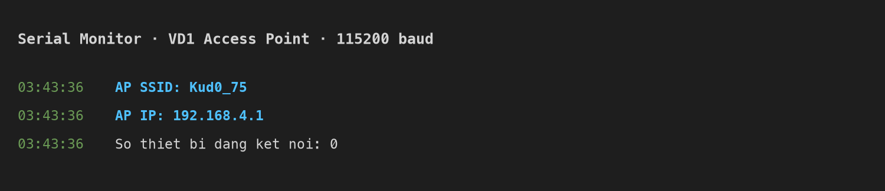
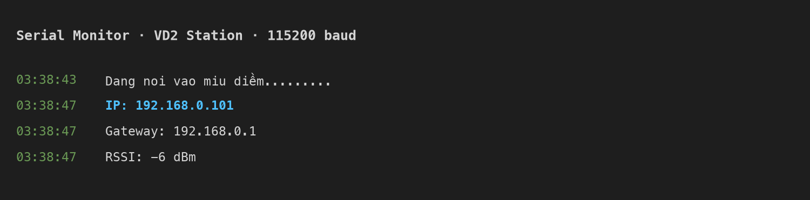

# Bài 1 · Wi-Fi: Access Point và Station

**SSID nhóm đã đặt:** `Kud0_75` (pass `password123`)

| Ví dụ | Kết quả |
|---|---|
| VD1 · Access Point | IP của AP: **192.168.4.1** — điện thoại quét thấy SSID `Kud0_75` |
| VD2 · Station | Nối vào router (2,4 GHz), IP nhận được: **192.168.0.101** (gateway 192.168.0.1) |

